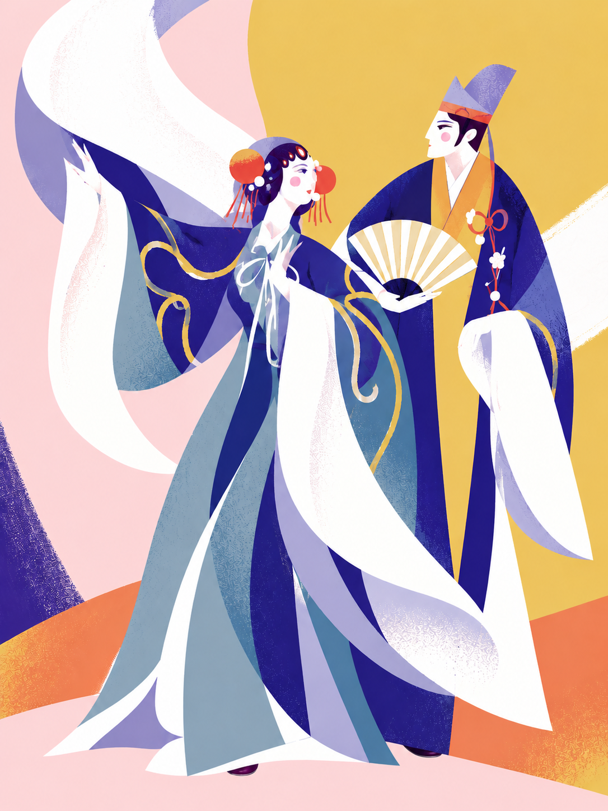
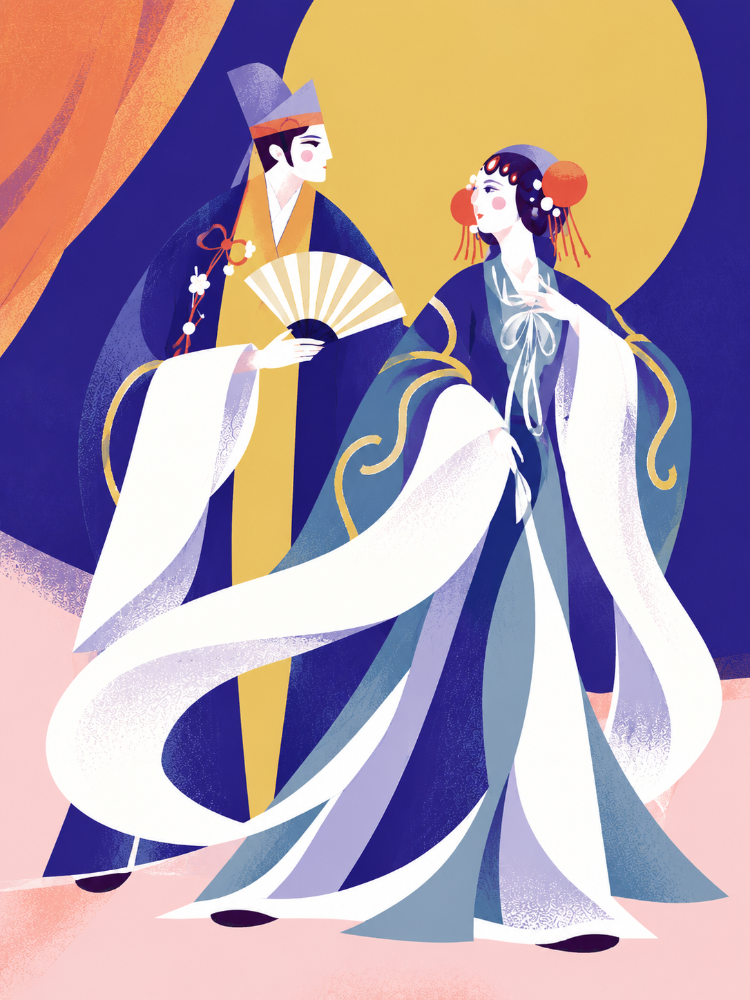
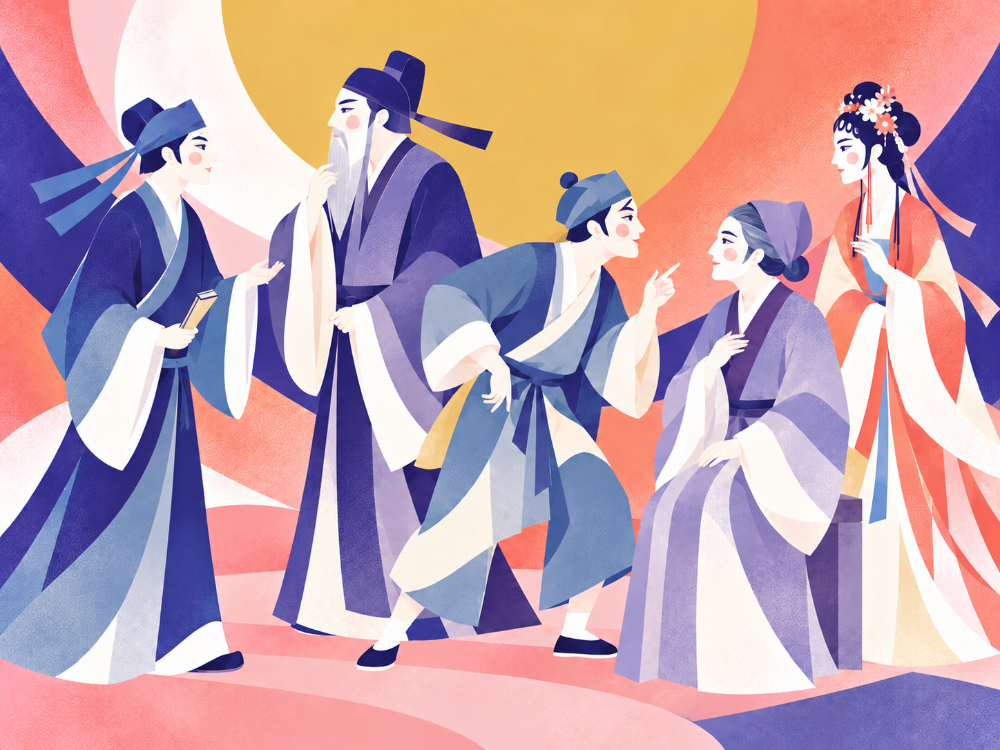

# ChatGPT 戏曲插画 Skill

用 **ChatGPT Images** 生成这类戏曲与江南插图：鲜明的大色块、舒展的水袖、简洁优雅的人物侧脸，以及克制的印刷纹理。

<p>



</p>

不只画人物。湖景、戏台、乐器、故事场景也可以延续同一套美术语言。

## 包含什么

- 8 张项目中选出的高清插图，作为风格参考。
- 一份可安装的 `SKILL.md`，说明如何选参考、组织画面、控制纹理和修正细节。
- 人物、湖景、乐器、叙事静物及局部修改的提示词模板。
- 示例图片来源文件与校验值，区分生成作品和最初的外部参考。

## 在 Codex 中使用

把 [`skills/chatgpt-opera-illustration`](skills/chatgpt-opera-illustration) 整个目录放入 `~/.codex/skills/`，然后在新会话中调用：

```text
用 $chatgpt-opera-illustration 画一张戏曲插图：
一位青衣转身回望，水袖从左下绕到右上。
靛蓝与暖白为主，少量珊瑚红。竖版，不要字。
```

也可以让支持 skill 安装的代理从本仓库的上述路径安装。

## 在 ChatGPT 中使用

选择支持图像生成的会话，上传 `references/images/` 中一到两张最相关的参考图，再使用 [`references/prompts.md`](skills/chatgpt-opera-illustration/references/prompts.md) 的风格块与题材提示词。明确说明“参考画风，重新设计构图”。

这是参考图与美术指导组成的 skill，**不是模型微调，也不是 ChatGPT 账户内的已安装功能**。需要可用的图像生成能力；不同生成结果仍需检查人物手脚、道具结构和构图。

## 更多例图

<p>



</p>
<p>


</p>

## 关于参考

图片来自人类持续美术指导、ChatGPT 图像生成与修改的合作项目，是风格示例，不是戏曲服饰考据或乐器结构教材。最初用户提供的 Behance 参考图目前没有可打包的原始文件，因此仓库保留其文字分析，没有冒用生成图替代原图。详见 [参考说明](skills/chatgpt-opera-illustration/references/index.md)。
